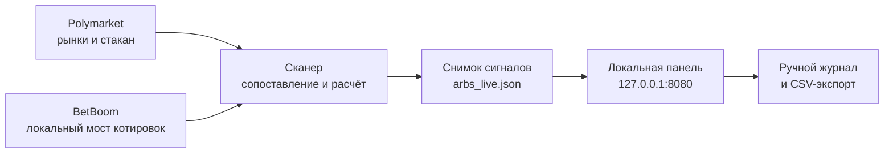

# Poly-ARB

> Локальный радар ценовых расхождений между рынками **Polymarket** и линией **BetBoom**.

Poly-ARB собирает доступные котировки, сопоставляет события и показывает расчётные сигналы и ориентировочные суммы. Проект находится в разработке: результаты зависят от свежести данных, ликвидности и корректности сопоставления рынков.

**Это не сервис ставок и не гарантия прибыли.** Программа не размещает ставки ни в букмекерской конторе, ни на Polymarket. Любой сигнал нужно проверить вручную до принятия решения.

## Текущее состояние

| Компонент | Статус |
|---|---|
| Polymarket | Используется для поиска рынков и чтения котировок/стакана |
| BetBoom | Основной источник букмекерских котировок по умолчанию; нужен отдельный локальный мост |
| 1win | Выключен в стандартном запуске; старый/экспериментальный путь не считается поддерживаемым источником |
| Панель | Локальный веб-интерфейс на `127.0.0.1:8080` |
| Исполнение ставок | Не автоматизировано |

Миграция источника котировок на 1win — отдельная незавершённая задача. Наличие старых файлов интеграции в репозитории не означает, что 1win включён или готов к работе.

## Возможности

- Мониторинг поддерживаемых live-событий и рынков Polymarket.
- Сопоставление исходов Polymarket с рынками BetBoom.
- Расчёт ориентировочного распределения банка, ROI и возможного результата с учётом курса, комиссии и доступной глубины стакана.
- Обновление списка рынков в watch-режиме и ограничение частоты повторных сигналов.
- Локальная панель: просмотр снимков сигналов, статуса свежести данных, истории цены и стакана Polymarket.
- Ручной журнал сделок в панели и экспорт записей в CSV. Сигнал сканера сам по себе не считается совершённой сделкой.
- Ориентир 40% от общего банка, который можно ввести отдельно в панели: он не меняет банк сканера и сохраняется только в браузере.

Дневная статистика основана на сохранённых пользователем записях с расчётными значениями. Она не подтверждает фактическое исполнение или финансовый результат, не считает все найденные сигналы и не создаёт автоматический отчёт в полночь.

Ручной калькулятор использует настройку комиссии из панели, а текущая модель сканера и API стакана — фиксированные 4%. Это оценочные параметры, а не автоматическое определение фактической комиссии площадки.

## Как устроен поток данных



## Установка и запуск

### Только веб-панель в Windows

Из корня репозитория:

```bat
git clone https://github.com/lap1xx/poly_fork.git
cd poly_fork
install_web.bat
start_all.bat
```

`install_web.bat` создаёт изолированное окружение `.venv` и устанавливает зависимости панели. `start_all.bat` запускает только `web_app.py` и открывает `http://127.0.0.1:8080`. **Сканер и мост BetBoom этим launcher-ом не запускаются.** Панель может показать имеющийся `arbs_live.json`; проверяйте возраст снимка, прежде чем считать данные актуальными.

### Сканер вместе с панелью

Сканер использует BetBoom-мост `chrome_bridge.py`. Мост подключается к локальному Chrome DevTools endpoint на `127.0.0.1:9222` и ретранслирует данные на `127.0.0.1:8765`. Он требует пакеты `websockets` и `playwright`, которых нет в базовом наборе зависимостей панели.

1. Настрой отдельный профиль Chrome и локальный DevTools endpoint. Не открывай порт удалённому доступу и не используй основной профиль браузера.
2. Установи дополнительные пакеты в `.venv` и запусти мост:

```bat
.venv\Scripts\python.exe -m pip install websockets playwright
.venv\Scripts\python.exe chrome_bridge.py
```

3. В другом терминале запусти сканер и панель:

```bat
.venv\Scripts\python.exe -B bot_live.py --min-roi 5.0 --bank 2000
```

`bot_live.py` запускает сканер и веб-панель. Не запускай одновременно `start_all.bat` и `bot_live.py`: оба могут занять порт `8080`. Остановить процесс можно через `Ctrl+C`.

> `chrome_bridge.py` подключается к уже работающему Chrome через CDP; автоматический запуск Chrome намеренно не встроен в безопасный launcher. Используй только локальный endpoint и отдельный профиль.

### Linux и macOS

Для панели установи Python 3.10+ и создай окружение вручную:

```bash
python3 -m venv .venv
source .venv/bin/activate
python -m pip install -r requirements.txt
python -B web_app.py
```

Для запуска сканера отдельно настрой совместимый локальный BetBoom-мост и необходимые для него пакеты. Windows-файлы `.bat` в Linux/macOS не используются.

## Параметры сканера

`bot_live.py` принимает `--min-roi` и `--bank`, а остальные дополнительные аргументы передаёт сканеру. Основные параметры:

| Параметр | Назначение |
|---|---|
| `--watch` | Периодически обновлять список live-рынков Polymarket |
| `--watch-sec N` | Интервал обновления списка рынков в секундах |
| `--live` | Помечать сканирование как live |
| `--poll N` | Интервал опроса в секундах |
| `--alert-gap N` | Минимальный интервал между обновлениями и повторными напоминаниями о сигнале |
| `--min-roi N` | Порог отображения сигнала в процентах |
| `--bank N` | Размер банка в рублях |
| `--no-bb` | Отключить букмекерский мост; без другого включённого источника сигналов не будет |

Например, для сканирования с более высоким порогом ROI:

```bat
.venv\Scripts\python.exe -B bot_live.py --min-roi 7 --bank 2500
```

`config.json` хранит настройки проекта, включая банк и курс. Обёртка `bot_live.py` передаёт сканеру собственные начальные значения: `--min-roi 5.0`, `--bank 2000`, `--watch-sec 20`, `--poll 0.3` и `--alert-gap 120`. Переданные аргументы командной строки переопределяют значения конфигурации.

## Ключевые изменения

В [PR #1](https://github.com/lap1xx/poly_fork/pull/1) исправлены и усилены основные части сканера и панели:

- **Расчёты и валидация.** Некорректные, бесконечные и неположительные входные значения отбрасываются. Исправлен учёт конвертации RUB/USD для Polymarket; при отсутствии валидного курса сканер не подставляет фиктивное значение `1:1`. Сигнал не проходит, если свежей глубины стакана недостаточно для расчётного объёма.
- **Данные и сигналы.** Polymarket feed обновляет подписки при изменении списка токенов, а некорректные уровни стакана отбрасываются. Дедупликация и `--alert-gap` не теряют последнее изменение сигнала; снимок выбирает лучший ROI по slug детерминированно.
- **Корректность сопоставления.** Неизвестный исход больше не назначается `home/away` только по порядку элементов. Сигналы сканера не выдаются за подтверждённые сделки.
- **Безопасность панели.** Добавлены проверки локального same-origin доступа и входных данных, атомарная запись настроек, безопасное экранирование HTML, корректный CSV-экспорт с защитой от formula injection и отображение возраста snapshot.
- **Более безопасный запуск.** Установка панели идёт в `.venv`; `start_all.bat` не убивает процессы, не запускает CDP-мост или сканер автоматически и открывает панель только на loopback.

Подробности и результаты проверок — в [CHANGELOG_FIXES.md](CHANGELOG_FIXES.md).

## Проверки

Запусти offline-тесты из корня проекта:

```bash
python -m unittest discover -s tests -v
```

В PR #1 прошли 12 unit-тестов на синтетических данных. Сетевые подключения к букмекерам и Polymarket в этих тестах не проверяются.

## Структура проекта

```text
polyarb_v4.py       Основной сканер, сопоставление событий и расчёты
bb_bridge.py        Клиент BetBoom-моста
chrome_bridge.py    Локальный relay между Chrome и сканером
bk_router.py        Роутер источников; 1win выключен по умолчанию
bk_adapter.py       Заглушка для вторичного букмекера
web_app.py          Backend локальной панели
static/             JavaScript и CSS панели
templates/          HTML-шаблон панели
price_history.py    История цен и глубины стакана
stats.py            Фильтрация и сводки сигналов
config.json         Локальные параметры проекта
requirements.txt    Базовые зависимости панели и сканера
tests/              Offline unit-тесты
```

## Важные ограничения

- Сигнал — расчётная возможность на момент получения данных, а не обещание гарантированной вилки или прибыли. Коэффициенты и глубина могут измениться до ручной проверки.
- Сканер только показывает данные и расчёты. Ставки не размещаются автоматически.
- В стандартной конфигурации используется BetBoom; 1win и другие БК не являются активными источниками.
- Локальная панель рассчитана на работу на этом компьютере и привязана к `127.0.0.1`. Не публикуй её порт в интернет.
- Используй проект с учётом правил платформ и применимого законодательства. Финансовые решения и их последствия остаются на пользователе.

---

Автор: [@lap1xx](https://github.com/lap1xx)
