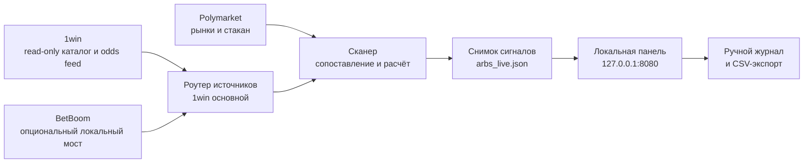

# Poly-ARB

> Локальный read-only монитор ценовых расхождений между Polymarket и 1win.

Poly-ARB получает рыночные данные, сопоставляет поддерживаемые события и показывает расчётные сигналы с ориентировочным распределением банка. Результаты зависят от свежести котировок, ликвидности стакана и точности сопоставления рынков.

**Это не сервис ставок и не гарантия прибыли.** Программа не размещает ставки ни в букмекерской конторе, ни на Polymarket. Кнопка букмекера открывает обычную страницу события 1win без суммы и купона; ставки пользователь проверяет и вводит самостоятельно.

## Текущее состояние

| Компонент | Статус |
|---|---|
| Polymarket | Чтение рынков и стакана для расчётов |
| 1win | Основной read-only источник коэффициентов; каталог и котировки поступают через REST и WebSocket |
| BetBoom | Резервный источник; требует отдельного локального Chrome-моста |
| Локальная панель | FastAPI на `127.0.0.1:8080`; может показывать последний снимок сканера |
| Автоматические ставки | Не реализованы и не выполняются |
| Telegram Mini App | Незавершённый прототип в `miniapp/`; не является текущей сборкой или deployment target |

В адаптере 1win настроены CS2, Dota 2, League of Legends, Valorant и теннис. Сопоставляются рынки победителя матча и победителя карты. Неоднозначные матчи и рынки отклоняются; открытые котировки старше 30 секунд не используются. При отсутствии двух пригодных цен 1win роутер может использовать BetBoom как резерв.

## Возможности и ограничения расчётов

- Обновление live-рынков Polymarket в watch-режиме и чтение доступной глубины стакана.
- Сопоставление команд и поддерживаемых рынков с 1win; при включённом резерве — переход на BetBoom, если 1win не готов или не даёт две свежие цены.
- Расчёт ориентировочных ставок, ROI и возможного результата с учётом курса, комиссии и глубины стакана.
- Локальная панель со статусом и возрастом данных, историей цены Polymarket, ручным журналом и CSV-экспортом.
- Статус цикла показывает число проверенных рынков, свежих bookmaker-котировок, фаз событий и причины отсева, включая невалидные рынки и ошибки расчёта. Неполное обновление каталога Polymarket помечается отдельно.
- Фаза события — `LIVE`, `PREMATCH` или `UNKNOWN`. `LIVE` выставляется только при явном сигнале источника; прошедшее время начала или суффикс карты/сета сами по себе не доказывают, что матч идёт.
- Планировщик банка автоматически уменьшает рекомендуемые ставки до ориентира **40% общего банка**; итоговые округлённые суммы также остаются в пределах лимита. При ручном изменении он показывает предупреждение о превышении; блокировки действий или автоматических ставок нет.

В watch-режиме пустой каталог не завершает сканер: он продолжает опрашивать Polymarket. Удаление исчезнувших рынков происходит только после полного обновления; ответы на пределе API `limit=200`, ошибки запросов или некорректные записи считаются неполными, поэтому прежний набор временно сохраняется.

Дневная статистика основана на сохранённых пользователем записях и не подтверждает фактические ставки или финансовый результат. Ручной калькулятор использует выбранную в панели комиссию, а модель сканера и API стакана — фиксированные 4%; это оценочные параметры.

## Поток данных



## Установка и запуск

Для Python-приложения требуется Python 3.10 или новее. Базовые зависимости панели и сканера описаны в `requirements.txt`.

### Windows: локальная панель без сканера

Из корня репозитория запусти:

```bat
install_web.bat
start_all.bat
```

`start_all.bat` запускает только панель и открывает `http://127.0.0.1:8080`. Он не запускает сканер или Chrome-мост. Панель может показать сохранённый `arbs_live.json`; проверь бейдж свежести перед использованием данных.

### Windows: сканер 1win + панель

После `install_web.bat` запусти из корня:

```bat
.venv\Scripts\python.exe -B bot_live.py --min-roi 5.0 --bank 2000
```

`bot_live.py` запускает сканер с watch-обновлением Polymarket и отдельно поднимает локальную панель на порту 8080. В штатном запуске 1win — основной bookmaker source; для прямого подключения к его read-only feed Chrome-мост не нужен. Не запускай параллельно `start_all.bat` и `bot_live.py`: они могут занять один и тот же порт панели. Остановка — `Ctrl+C`.

Флаг `--no-bb` отключает только BetBoom fallback, оставляя 1win активным:

```bat
.venv\Scripts\python.exe -B bot_live.py --no-bb --min-roi 5.0 --bank 2000
```

### Необязательный BetBoom fallback

BetBoom-мост нужен только если ты хочешь использовать резервный источник. Он работает через отдельный Chrome-профиль и локальный DevTools/WebSocket relay. Не открывай CDP-порт в интернет и не используй основной профиль браузера.

```bat
.venv\Scripts\python.exe -m pip install websockets playwright
.venv\Scripts\python.exe -m playwright install chromium
.venv\Scripts\python.exe chrome_bridge.py
```

Оставь мост запущенным и в другом окне выполни команду запуска `bot_live.py` выше. Без работающего моста BetBoom fallback будет недоступен, но 1win остаётся основным источником.

### Linux и macOS

Панель отдельно:

```bash
python3 -m venv .venv
source .venv/bin/activate
python -m pip install -r requirements.txt
python -B web_app.py
```

Сканер вместе с панелью:

```bash
.venv/bin/python -B bot_live.py --min-roi 5.0 --bank 2000
```

Windows-файлы `.bat` в Linux/macOS не используются. Для BetBoom fallback потребуются браузерный мост и его дополнительные зависимости; для подключения 1win они не нужны.

## Настройки адаптера 1win

Адаптер читает каталог матчей и odds feed, не обращается к API купона, аккаунта или кошелька и не посылает заголовки для подмены региона. При необходимости параметры подключения можно задать переменными окружения:

- `ONEWIN_API_BASE` — адрес API gateway.
- `ONEWIN_ORIGIN` — домен обычной страницы события.
- `ONEWIN_LANGUAGE` и `ONEWIN_PARTNER_ID` — параметры клиента.
- `ONEWIN_MAX_ODDS_AGE_SECONDS` — допустимый возраст котировки, от 1 до 600 секунд; по умолчанию 30.

Меняй эти значения только для домена и параметров, к которым у тебя есть доступ и разрешение. Ссылка на матч не содержит суммы, ставки или данных купона.

Сканер подписывается на odds только после успешного сопоставления рынка, а не на первые 30 случайных событий каталога. При обновлении каталога уже полученные котировки сохраняются для матчей, которые остались в каталоге; возраст котировки обновляется только при получении валидного коэффициента (`cf`), а не при status-only delta. Ограничение свежести остаётся 30 секунд.

Сопоставление рынка работает fail-closed: totals, handicaps, неизвестные типы, player props и tennis set-winner не связываются с рынком победителя матча. Единственное послабление для поиска — tennis (`sportId=33`): если обе команды достаточно похожи (score ≥ 0.60) и ровно один кандидат имеет время начала в пределах часа от Polymarket, его можно принять с причиной `matched_time_corroborated`; неоднозначные пары остаются отклонёнными. В `match_diagnostics.json` доступны подтипы неподдерживаемых рынков, а `scanner_status.json` содержит `bookmaker_feed_health.1win` с состоянием соединения, свежими/устаревшими открытыми котировками и временем последнего сообщения/валидной цены. Gamma каталоги загружаются параллельно по семи группам (не более семи workers; timeout каждого запроса — 3 секунды connect / 5 секунд read), чтобы одна недоступная группа не задерживала последовательный перебор всех 14 запросов. Итоги и типы ошибок записываются в `pm_catalog_fetch` и показываются в health panel.

## Событийный пересчёт и доставка в панель

После начальной оценки каталога сканер ставит в coalescing-очередь ID изменившихся PM token books и 1win matches. Обратные индексы разрешают эти ID только в связанные PM slug; единственный scanner dispatcher пересчитывает их последовательно, а не перебирает весь каталог на каждом изменении. Полный расчёт остаётся при первичной загрузке и изменении каталога. Повторный binding выполняется раз в 10 секунд; активные сигналы перепроверяются на истечение свежести раз в секунду. Для рынков, где фактически выбран BetBoom fallback (у него пока нет callback-интеграции), остаётся ограниченный односекундный polling; основной 1win путь и Polymarket book идут по событиям.

`bot_live.py` генерирует одноразовый случайный `POLYARB_SCANNER_WS_TOKEN` и передаёт его backend/scanner только через окружение дочерних процессов. Scanner отправляет полные согласованные snapshots на локальный `ws://127.0.0.1:8080/ws/scanner`; endpoint принимает только loopback bearer-authenticated сообщения со схемой/сессией/монотонным sequence и размером до 8 MiB. Токен не попадает в URL, командную строку, конфиг или браузер. Публичный для локального UI endpoint `/ws` остаётся read-only; backend будит fanout сразу после получения scanner snapshot. Если scanner heartbeat отсутствует более 3 секунд, backend автоматически возвращается к `arbs_live.json` и `scanner_status.json`; в health panel этот канал явно помечается как `файловый fallback`. Файлы продолжают писаться атомарно, а восстановленный publisher начинает прямую доставку заново после reconnect.

В карточке здоровья панели показываются количество рынков текущего событийного пакета, размер очереди, прямой/fallback канал доставки, сопоставленные и несопоставленные PM-рынки, число событий в каталоге 1win, количество свежих открытых котировок и задержки `feed→расчёт`, `сканер→backend` и локального рендера DOM. Эти метрики измеряют только участки внутри нашего процесса/локального контура; задержка публикации исходной площадкой и внешней сети в них не входит. `--no-web` сохраняет старый режим: прямой ingest используется только если задан совместимый `POLYARB_SCANNER_WS_TOKEN`, иначе работает файловый fallback.

## Проверки

Из корня репозитория запусти offline-тесты:

```bash
python -m unittest discover -s tests -v
node tests/test_bankroll_plan.cjs
```

Проверки синтаксиса основных модулей и dashboard JavaScript:

```bash
python -m py_compile event_phase.py event_dispatch.py scanner_publisher.py onewin_bridge.py bk_router.py polyarb_v4.py web_app.py bot_live.py
node --check static/app.js
node --check static/bankroll_plan.js
```

Корневой dashboard не требует отдельной frontend-сборки: HTML, CSS и JavaScript обслуживает FastAPI. Read-only проверку доступности 1win feed можно запустить отдельно:

```bash
python -B onewin_bridge.py --verbose --smoke-seconds 10
```

Smoke test требует сетевого доступа к настроенному API gateway. Unit-тесты работают на синтетических данных и не заменяют периодическую проверку живой свежести источников.

Для разбора причин несопоставления сканер атомарно создаёт `match_diagnostics.json`: по каждому активному PM-рынку записывается результат, причина отказа и до трёх ближайших событий 1win. `team_aliases.json` содержит ручные группы проверенных вариантов названий; добавляй варианты в одну группу только если это точно одна команда, не объединяй основной состав с academy/youth. После правки alias-файла перезапусти сканер. При необходимости путь можно задать переменной `ONEWIN_TEAM_ALIASES_FILE`.

## Деплой и безопасность

Текущая панель предназначена для локального компьютера: `web_app.py` слушает `127.0.0.1:8080`, а изменяющие API-запросы разрешены только с локального same-origin. **Не публикуй приложение напрямую в интернет и не считай GitHub Pages подходящим хостингом для полного backend.** Публичный деплой потребует отдельной схемы аутентификации, защищённого хранения состояния, внешнего listener и настройки origin/HTTPS.

`miniapp/` оставлен как незавершённый Telegram Mini App prototype. Он не включён в установку, сборку и проверки текущего локального dashboard.

## Структура проекта

```text
polyarb_v4.py       Сканер, Polymarket рынки, расчёты и диагностика циклов
event_dispatch.py   Coalescing-очередь и обратные индексы dirty markets
scanner_publisher.py Локальный аутентифицированный WebSocket publisher
event_phase.py      Консервативная классификация LIVE/PREMATCH/UNKNOWN
onewin_bridge.py    Read-only каталог и odds feed 1win
bk_router.py        1win primary и BetBoom fallback
bb_bridge.py        Клиент локального BetBoom-моста
chrome_bridge.py    Необязательный relay через отдельный Chrome
web_app.py          Backend локальной панели
static/             JavaScript и CSS панели
templates/          HTML-шаблон панели
scanner_status.json  Runtime-сводка цикла (создаётся сканером, не коммитится)
match_diagnostics.json Runtime-диагностика сопоставления (создаётся сканером)
pm_book_diagnostics.json Runtime-диагностика отсутствующего PM ask по токенам
team_aliases.json    Ручные проверенные группы вариантов названий команд
price_history.py    История цены и глубины Polymarket
stats.py            Фильтрация и сводки сигналов
config.json         Параметры сканера
onewin_data_source_audit.md  Техническая заметка по источнику 1win
tests/              Offline regression tests
miniapp/            Незавершённый экспериментальный прототип
```

Более подробная запись о маршрутах 1win, схемах данных и защитах сопоставления находится в [onewin_data_source_audit.md](onewin_data_source_audit.md).

`pm_book_diagnostics.json` показывает по каждому пропущенному PM ask состояние CLOB-книги (`missing_book`, `stale_book`, `empty_asks` или `empty_book`), token ID, исход и результат фонового read-only запроса к `/book`. Для отсутствующей или устаревшей локальной книги сканер делает ограниченный по частоте REST refresh (не чаще раза в 20 секунд на token, не более 4 одновременных запросов). Пустой asks после успешного ответа — это отсутствие доступных заявок на продажу, а не цена, которую можно безопасно восстановить из последней сделки. Скрипт не выставляет и не изменяет ордера.

`scanner_status.json` также содержит `best_candidate_roi_pct` и `best_candidate_slug`: лучший ROI кандидата после проверки глубины и уточнения цены, даже если он ниже заданного порога показа. Если валидных кандидатов нет, ROI будет `null`.

## Важные ограничения

- Сигнал — расчётная возможность на момент получения данных, а не обещание гарантированной вилки или прибыли. Коэффициенты и глубина могут измениться до ручной проверки.
- Несовпадающие или неоднозначные события и рынки намеренно не используются; stale котировки 1win не считаются пригодными.
- Скрипт не размещает ставки. Проверяй исходы, правила расчёта, доступный объём и свежесть данных вручную.
- Локальная панель привязана к `127.0.0.1`; не открывай её порт в интернет.
- Используй проект с учётом правил платформ и применимого законодательства. Финансовые решения и их последствия остаются на пользователе.

---

Автор: [@lap1xx](https://github.com/lap1xx)
